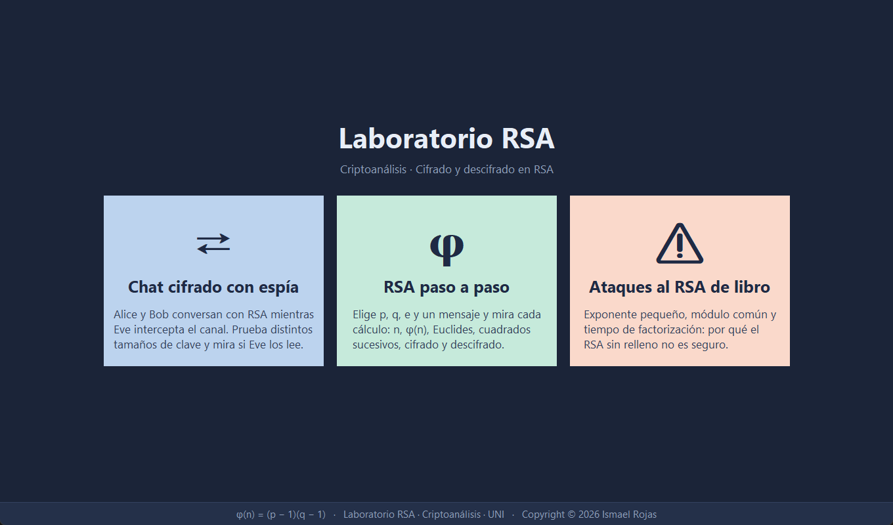
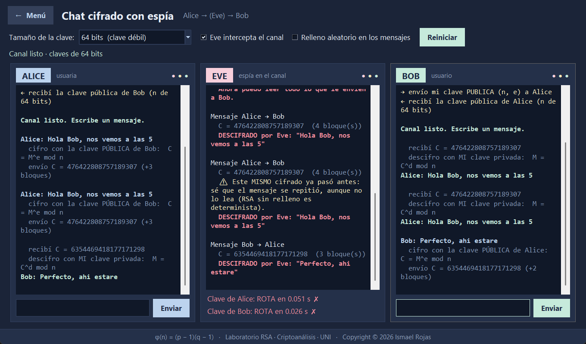
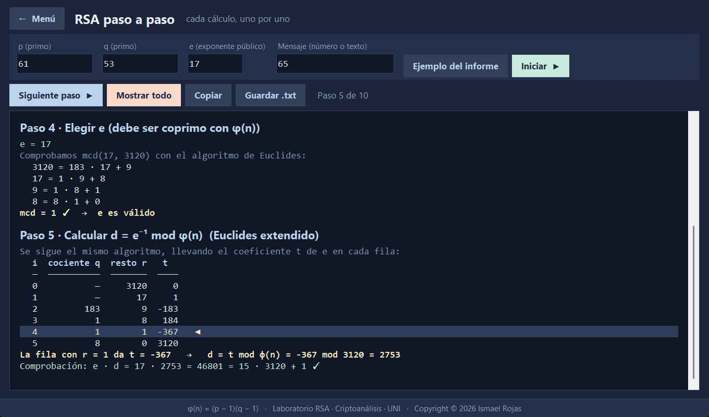
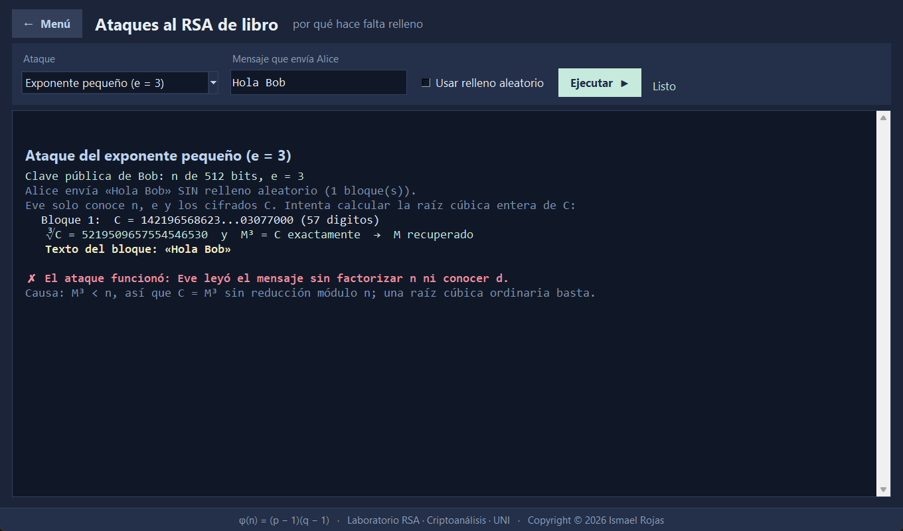

# Laboratorio RSA

Aplicación de escritorio para **aprender y atacar RSA**. Implementa el cifrado RSA desde cero en Python
(sin bibliotecas criptográficas), lo muestra paso a paso y permite ver qué pasa cuando un espía intenta
romperlo. Hecha para el curso de **Criptoanálisis – Cifrado y Descifrado en RSA** (UNI).

* Python 3.8 o superior, **sin dependencias** (solo la biblioteca estándar; Tkinter viene incluido).
* Desarrollada y probada con Python 3.13.

> ⚠️ **Solo con fines educativos.** Es RSA «de libro de texto»: no usa OAEP ni protege contra canales
> laterales. No lo uses para proteger información real; para eso existen bibliotecas como
> [`cryptography`](https://cryptography.io).

## Qué incluye

El programa tiene tres opciones en el menú:

| Opción | Qué hace |
|---|---|
| **Chat cifrado con espía** | Alice y Bob conversan con RSA mientras Eve intercepta el canal e intenta factorizar sus claves. Cambia el tamaño de la clave y comprueba si Eve puede leer la conversación. |
| **RSA paso a paso** | Elige `p`, `q`, `e` y un mensaje y mira los 10 cálculos: `n`, `φ(n)`, Euclides extendido, cuadrados sucesivos, cifrado, descifrado, Teorema Chino del Resto y verificación. Se puede copiar o guardar en `.txt`. |
| **Ataques al RSA de libro** | Exponente pequeño (`e = 3`), módulo común y medición del tiempo de factorización con extrapolación a claves mayores. Con el relleno aleatorio activado, los ataques fallan. |

## Capturas

**Menú principal**



**Chat con espía:** con una clave de 64 bits, Eve la rompe en milisegundos y lee la conversación. Al repetirse
un mensaje sin relleno, además avisa de que el cifrado es idéntico.



**RSA paso a paso:** el ejemplo `p = 61`, `q = 53`, `e = 17` con la tabla de Euclides extendido que da `d = 2753`.



**Ataque del exponente pequeño:** con `e = 3` y un mensaje corto, Eve lo lee sin factorizar `n`.



## Cómo ejecutarlo

```
git clone https://github.com/Ismaelrojas0112/laboratorio-rsa.git
cd laboratorio-rsa
python app.py
```

En Linux, si dice que falta `tkinter`: `sudo apt install python3-tk`.
Los botones se manejan también con el teclado (Tab para moverse, Enter o Espacio para pulsar).

## Opción 1: Chat cifrado con espía

Tres terminales simuladas en la misma ventana: **Alice**, **Eve** (espía, solo lectura) y **Bob**.

1. Elige el tamaño de la clave y pulsa **Conectar**.
2. Escribe un mensaje en la caja de Alice o de Bob y pulsa Enter.
3. Mira qué ve cada uno: Alice y Bob muestran cómo cifran con la clave pública del otro y descifran
   con la suya; Eve muestra lo que intercepta y si logra romper la clave.

| Tamaño | Qué pasa (Pollard rho, 15 s) |
|---|---|
| 64 bits (débil) | Eve factoriza `n` en milisegundos, calcula `d` y lee todo. |
| 96 bits | Está al límite: rho tarda unos 7–9 s, así que suele caer justo a tiempo. |
| 128, 256 y 512 bits | Eve intenta 15 s y se rinde: «RESISTIÓ ✓». |
| 2048 bits (segura) | Igual; las claves tardan 1–3 s en generarse. |

«Resistió» solo significa que **este** ataque (Pollard rho) no alcanza. Con algoritmos mejores
(criba general del cuerpo de números) 128, 256 y 512 bits sí se rompen; 2048 bits no.

Casillas:

* **Eve intercepta el canal**: permite probar la conversación sin espía.
* **Relleno aleatorio en los mensajes**: sin relleno, enviar dos veces el mismo texto produce el mismo
  cifrado y Eve lo avisa («este MISMO cifrado ya pasó antes») aunque no pueda leerlo. Con relleno, cada
  cifrado es distinto.

## Opción 2: RSA paso a paso

Pon `p`, `q`, `e` y un mensaje (un número, o un texto corto como `A`) y pulsa **Iniciar**. Avanza con
**Siguiente paso** o pulsa **Mostrar todo**. «Ejemplo del informe» carga `p = 61`, `q = 53`, `e = 17`,
`M = 65`. Acepta primos de hasta 19 dígitos.

## Opción 3: Ataques al RSA «de libro»

Muestra por qué el RSA sin relleno no es seguro aunque la clave sea grande (512 bits):

* **Exponente pequeño (`e = 3`)**: si el mensaje es corto, `M³ < n`, así que `C = M³` sin reducción y Eve
  lo recupera con una raíz cúbica entera, sin factorizar nada.
* **Módulo común**: dos usuarios con el mismo `n` y exponentes distintos (17 y 65537) reciben el mismo
  mensaje. Con Euclides extendido (`a·e₁ + b·e₂ = 1`), Eve calcula `C₁ᵃ · C₂ᵇ = M` sin ninguna clave privada.
* **Tiempo de factorización**: rompe claves de 32 a 88 bits, mide cuánto tarda y extrapola a 128, 256, 512,
  1024 y 2048 bits (el tiempo de rho se duplica cada 4 bits de `n`). Tarda unos segundos.

## Estructura del proyecto

| Archivo | Contenido |
|---|---|
| `app.py` | La ventana (menú, chat con espía, paso a paso, ataques) |
| `sesion_chat.py` | Lógica del chat (claves, cifrado, lo que ve Eve), sin interfaz |
| `pasos.py` | Los cálculos del paso a paso, sin interfaz |
| `ataques.py` | Ataques de exponente pequeño y módulo común; medición de tiempos |
| `rsa_didactico.py` | RSA desde cero: Euclides extendido, exponenciación modular, Miller–Rabin, claves, cifrado, TCR |
| `herramientas.py` | Cifrado de textos por bloques (con relleno opcional) y ataque de factorización (Pollard rho–Brent) |
| `test_rsa.py` | Pruebas automáticas |

## Pruebas

```
python -m unittest -v
```

Tardan unos 3 segundos.

## Notas

* Para cambiar cuánto tiempo intenta Eve romper una clave, edita `ATAQUE_SEG` al inicio de `app.py`.
* El «relleno aleatorio» es una versión simplificada de PKCS#1 v1.5 (`0x02 ‖ bytes aleatorios ‖ 0x00 ‖ texto`)
  pensada para ver su efecto; no sustituye a OAEP.
* El módulo se llama `rsa_didactico` y no `rsa` para no chocar con la biblioteca `rsa` de PyPI.

## Licencia

[MIT](LICENSE) © 2026 Ismael Rojas
